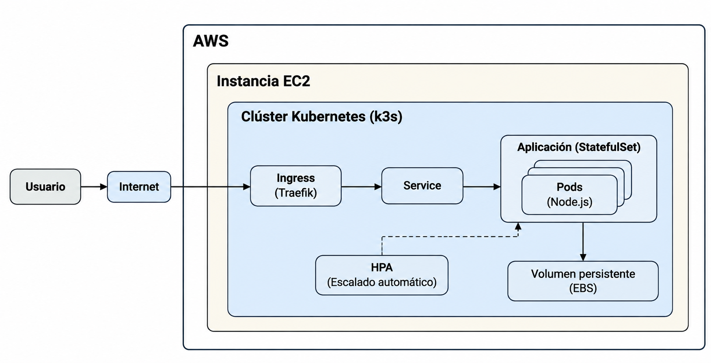
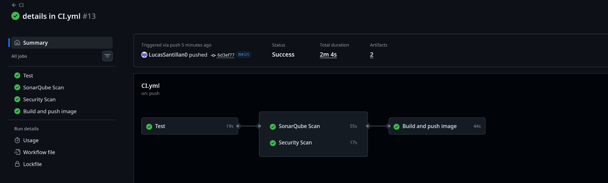
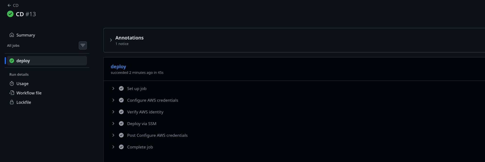
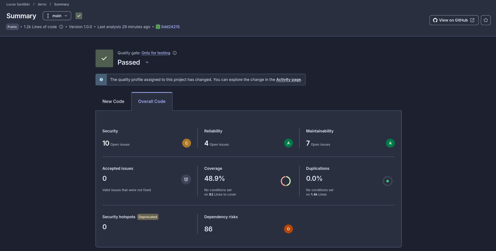

# DevOps Technical Challenge — Node.js API on AWS

[](https://github.com/LucasSantillan0/devsu-devops-test/actions/workflows/CI.yml)
[](https://github.com/LucasSantillan0/devsu-devops-test/actions/workflows/CD.yml)

Implementación de una prueba técnica DevOps a partir de la aplicación Node.js proporcionada por Devsu. La solución incorpora contenedorización, integración y despliegue continuos, análisis de código, Kubernetes, escalamiento horizontal e infraestructura como código en AWS.

**Repositorio:** https://github.com/LucasSantillan0/devsu-devops-test  
**Ejecuciones CI/CD:** https://github.com/LucasSantillan0/devsu-devops-test/actions  
**Endpoint de demostración:** http://18.229.36.187/api/users *(sujeto a que la instancia de demostración permanezca activa; confirmar la Elastic IP con `terraform output`)*.

> Este entorno es una demostración técnica, no una arquitectura de alta disponibilidad para producción. Las limitaciones y mejoras recomendadas se detallan al final.

## 1. Arquitectura



El diseño separa **aprovisionamiento**, **integración continua** y **despliegue**:

1. **Terraform** aprovisiona la red de AWS, EC2, IAM, Systems Manager, una Elastic IP y un volumen EBS para los datos.
2. **Cloud-init** prepara la instancia Amazon Linux: identifica y monta el EBS en `/data`, instala k3s y Helm y configura el almacenamiento local de Kubernetes en `/data/k3s-storage`.
3. **GitHub Actions (CI)** instala dependencias, ejecuta pruebas y cobertura, analiza el código con SonarQube Cloud, realiza un escaneo con Trivy y publica una imagen etiquetada por commit en **GitHub Container Registry (GHCR)**.
4. **GitHub Actions (CD)** se activa tras un CI exitoso en `main`, obtiene credenciales temporales mediante **GitHub OIDC**, y envía la operación de despliegue a la EC2 mediante **AWS Systems Manager Run Command**.
5. En EC2, **Helm** aplica el chart al namespace `devops`. **Traefik Ingress** recibe las solicitudes HTTP y las dirige al **Service ClusterIP** de la API.
6. La API corre en un **StatefulSet** con al menos dos réplicas. Cada Pod dispone de su propio PVC y archivo SQLite. El **HPA** puede escalar de dos a tres réplicas en función del uso de CPU.

### Componentes principales

| Capa | Herramienta / recurso | Responsabilidad |
| --- | --- | --- |
| Aplicación | Node.js, Express, Sequelize, SQLite | API HTTP de usuarios |
| Contenedor | Docker (multi-stage) | Empaquetado y ejecución de la API |
| Integración continua | GitHub Actions, Jest, SonarQube Cloud, Trivy | Tests, cobertura, análisis, imagen y publicación |
| Registro | GHCR | Almacenamiento de imágenes por SHA |
| Infraestructura | Terraform, AWS VPC, EC2, EBS, IAM | Recursos cloud reproducibles |
| Bootstrap | Cloud-init | Instalación de k3s, Helm y montaje de datos |
| Administración remota | AWS Systems Manager | Operación y despliegue sin exponer SSH ni la API de Kubernetes |
| Orquestación | k3s (Kubernetes) | StatefulSet, Services, PVC, ConfigMap, Ingress, HPA |
| Despliegue | Helm, GitHub Actions CD | Actualizaciones automatizadas con rollback de Helm |

## 2. Estructura del repositorio

```text
.
├── .github/workflows/
│   ├── CI.yml                  # Tests, SonarQube, Trivy, build y push a GHCR
│   └── CD.yml                  # OIDC + SSM + helm upgrade --install
├── helm/
│   ├── Chart.yaml
│   ├── values.yaml
│   └── templates/             # StatefulSet, HPA, Services, Ingress, ConfigMap, PVC...
├── terraform/
│   ├── main.tf
│   ├── variables.tf
│   ├── outputs.tf
│   ├── cloud-init.yaml
│   └── modules/               # VPC, EC2 y otros recursos asociados
├── shared/                    # Base de datos y módulos compartidos
├── users/                     # Endpoints de usuarios     
├── Dockerfile
├── healthcheck.js
├── index.js
├── index.test.js
└── package.json
```

## 3. Ejecutar la aplicación localmente

**Requisitos:** Node.js y npm compatibles con las dependencias del proyecto.

```bash
git clone https://github.com/LucasSantillan0/devsu-devops-test.git
cd devsu-devops-test
npm ci
npm test
npm run coverage
npm start
```

La API utiliza el puerto `8000`. Para comprobarlo:

```bash
curl -i http://localhost:8000/health/live
curl -i http://localhost:8000/api/users
```

En el proyecto, la ruta de SQLite se configura mediante `DATABASE_PATH`. Para persistencia local, se puede definir una ruta de archivo con permisos de escritura.

Si la variable no está definida, la configuración de SQLite puede utilizar una base en memoria; esa modalidad no conserva datos entre reinicios.

### Contenedor Docker

```bash
docker build -t devsu-devops-test:local .
docker run --rm -p 8000:8000 devsu-devops-test:local
```

El Dockerfile utiliza etapas separadas para la instalación y la ejecución, un usuario no privilegiado y un healthcheck HTTP. Para conservar SQLite al reiniciar el contenedor hay que configurar un volumen montado y `DATABASE_PATH` apuntando a él.

## 4. API y endpoint público

La API expone las siguientes rutas:

| Método | Ruta | Uso |
| --- | --- | --- |
| `GET` | `/health/live` | Comprobación de salud |
| `GET` | `/api/users` | Listar usuarios |
| `GET` | `/api/users/:id` | Obtener un usuario |
| `POST` | `/api/users` | Crear un usuario |

Ejemplos contra la demostración desplegada:

```bash
curl -i http://18.229.36.187/health/live
curl -i http://18.229.36.187/api/users

curl -X POST http://18.229.36.187/api/users \
  -H 'Content-Type: application/json' \
  -d '{"dni":"demo-001","name":"Demo User"}'
```

El Ingress está configurado sin un host obligatorio para que el endpoint pueda consultarse directamente mediante la Elastic IP. **Actualmente el acceso es HTTP, sin certificado TLS**. Para un entorno real se requeriría DNS y HTTPS.

**Advertencia sobre los resultados:** cada réplica mantiene una base SQLite independiente. Si las solicitudes atraviesan el Service, pueden llegar a Pods diferentes y mostrar datos distintos. Este comportamiento se explica en [Limitaciones](#9-limitaciones-y-consideraciones-para-producción).

## 5. Infraestructura como código: Terraform


El módulo utiliza una EC2 `t3.small` como configuración de demostración, una subred pública, una Elastic IP y un volumen EBS adicional de 20 GiB. El arranque inicial configura k3s a través de cloud-init.

La política de confianza del rol de CD restringe GitHub OIDC al repositorio y referencia autorizados. Si se reproduce este proyecto desde otro repositorio, hay que actualizar `github_oidc_subject` en la configuración de Terraform para que coincida con el `sub` emitido por GitHub.

**Outputs relevantes:** `instance_id`, `instance_public_ip`, `data_volume_id`, `vpc_id`, `public_subnet_id`, `security_group_id`. El rol OIDC para CD también debe existir en la cuenta AWS donde corre la infraestructura.


## 6. CI/CD automatizado

### CI — `.github/workflows/CI.yml`

Se ejecuta al hacer `push` a `main` e incluye:

- Instalación de dependencias y pruebas con Jest.
- Reporte de cobertura, publicado como artifact del workflow.
- Análisis estático y Quality Gate con SonarQube Cloud.
- Escaneo del repositorio con Trivy (dependencias, secretos y configuraciones).
- Build de imagen Docker y publicación en GHCR con el tag `sha-<GITHUB_SHA>`.

**Análisis de seguridad y Calidad:** El pipeline incluye un escaneo de vulnerabilidades configurado en modo informativo (`exit-code: '0'`) y análisis de calidad con SonarQube con Quality Gate muy permisivo.

Esta decisión se tomó porque la aplicación base proporcionada para el ejercicio presenta hallazgos que provocarían fallos en el pipeline. Se optó por conservar sus dependencias y evitar modificaciones adicionales fuera del alcance de la prueba, facilitando la evaluación de la solución DevOps sin introducir cambios innecesarios en la aplicación original.

Los hallazgos se mantienen visibles en los resultados del pipeline. En un entorno productivo, se deberían evaluar y remediar las vulnerabilidades identificadas, configurar umbrales de severidad y habilitar el bloqueo del despliegue cuando corresponda.

### CD — `.github/workflows/CD.yml`

Al finalizar exitosamente CI en `main` (o mediante ejecución manual autorizada):

1. Obtiene credenciales temporales de AWS con OIDC, sin access keys almacenadas en GitHub.
2. Ejecuta un comando sobre la EC2 mediante `AWS-RunShellScript` de Systems Manager.
3. Descarga el chart correspondiente al commit y ejecuta `helm lint`.
4. Aplica `helm upgrade --install` con la imagen etiquetada por el mismo SHA y la opción `--atomic`.
5. Consulta la ejecución de SSM y falla el workflow si falla el despliegue.

**Configuración requerida en GitHub Actions:**

| Tipo | Nombre | Contenido |
| --- | --- | --- |
| Variable | `AWS_CD_ROLE_ARN` | ARN del rol IAM asumible por GitHub OIDC |
| Variable | `AWS_REGION` | `sa-east-1` |
| Variable | `AWS_INSTANCE_ID` | ID actual de la instancia EC2 |
| Secret | `SONAR_TOKEN` | Token del proyecto SonarQube Cloud |

La imagen de GHCR debe ser accesible para el clúster. Si el paquete es privado, hay que incorporar credenciales de lectura mediante `imagePullSecrets`.

**Ejecuciones públicas:** [GitHub Actions — CI/CD](https://github.com/LucasSantillan0/devsu-devops-test/actions).

## 7. Kubernetes y Helm

El chart `helm/` crea y configura los recursos de la aplicación en el namespace `devops`:

- **StatefulSet:** identidad de Pod estable y persistencia independiente para cada réplica.
- **Service ClusterIP:** enruta solicitudes a los Pods disponibles.
- **Headless Service:** identidad de red estable requerida por el StatefulSet.
- **Ingress Traefik:** publica la API mediante HTTP en la IP pública de EC2.
- **ConfigMap:** configuración no sensible (`NODE_ENV`, `PORT`, `DATABASE_PATH`).
- **PVCs:** almacenamiento local provisionado en el EBS montado en `/data/k3s-storage`.
- **HPA:** mínimo 2, máximo 3 réplicas, con objetivo de CPU del 70 %.
- **Readiness/Liveness probes** y límites de CPU y memoria.

Las credenciales de AWS y el token de SonarQube **no están almacenados en el chart**. La aplicación SQLite no requiere usuario ni contraseña de base de datos; por ello no se utiliza actualmente un Secret de Kubernetes para conexión a la base. Este punto se documenta porque el enunciado menciona Secrets entre los recursos esperados. Si la aplicación incorpora credenciales, deben suministrarse mediante un mecanismo seguro de secretos, no valores literales en Git.


## 8. Evidencias para la evaluación

La consigna solicita explícitamente el resultado de los pipelines y las salidas de IaC. Adjuntar al repositorio (por ejemplo, en `docs/evidence/`) lo siguiente, **después de ejecutar y verificar cada prueba**:

## CI Exitoso


https://github.com/LucasSantillan0/devsu-devops-test/actions/runs/43436803100

## CD Exitoso


https://github.com/LucasSantillan0/devsu-devops-test/actions/runs/43437100776

## Infraestructura creada

Salida de terraform apply en docs/evidence/terraform-apply.logs

Output de terraform

data_volume_id = "vol-0e16d8ccaf6853904"
github_cd_role_arn = "arn:aws:iam::982498569241:role/devops-github-cd"
instance_id = "i-05f9799f1627fd0eb"
instance_public_ip = "18.229.36.187"
public_subnet_id = "subnet-0d73a2d1c9bb0f15e"
security_group_id = "sg-0bcec3dd12afd9020"
vpc_id = "vpc-0071a09053b0b186a"
                                     
## Resultado de SonarQube



## Endpoint publico

http://18.229.36.187/health/live


## 9. Limitaciones y consideraciones para producción

| Decisión de la prueba | Limitación | Alternativa para producción |
| --- | --- | --- |
| SQLite por réplica | Cada Pod tiene una base distinta; no hay consistencia de datos entre réplicas | PostgreSQL/RDS compartido y migraciones de esquema |
| EC2 única con k3s | El nodo es un punto único de falla | Clúster multi-nodo y multi-AZ (por ejemplo, EKS) |
| EBS con `local-path` | Los volúmenes están vinculados al nodo; no son almacenamiento compartido entre nodos | CSI de EBS, estrategia de recuperación y backups, según la carga |
| IP pública sin dominio | No hay HTTPS ni certificados | DNS, HTTPS/TLS y gestión de certificados |
| Trivy informativo | Vulnerabilidades detectadas pueden no bloquear CI | Política de severidad y escaneo de imagen en el pipeline |
| Recursos limitados de `t3.small` | El HPA puede quedarse sin capacidad de nodo | Monitoreo, dimensionamiento y autoscaling de nodos |
| Terraform local | No hay backend compartido ni protección de estado centralizada | Backend remoto con cifrado, locking y acceso restringido |

**Decisiones de seguridad implementadas:** usuario no root para la aplicación, controles de salud, límites de recursos, permisos de GitHub Actions, credenciales AWS temporales mediante OIDC y administración mediante SSM, evitando abrir SSH y Kubernetes API a Internet.

